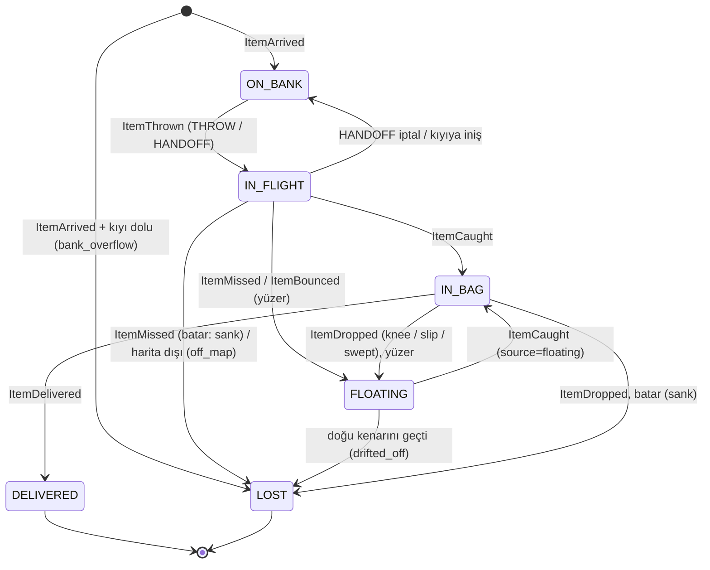
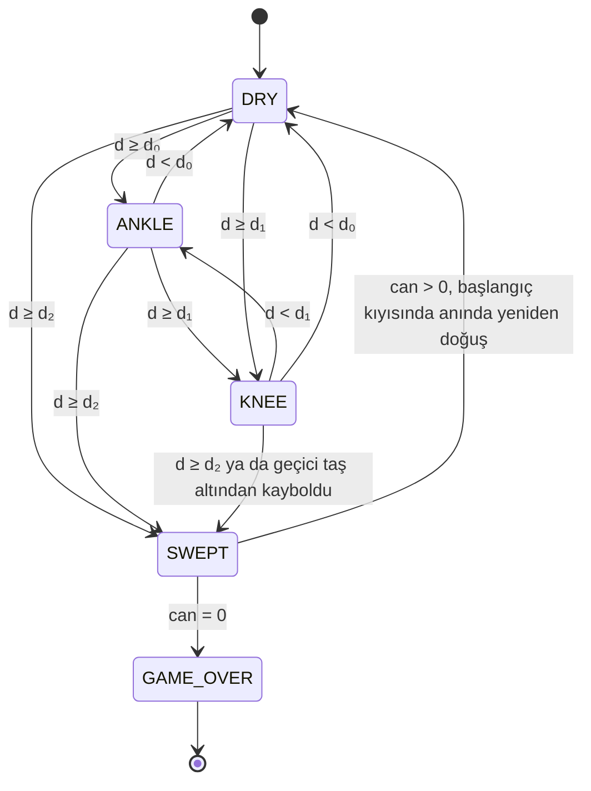

# Varlıklar (ENTITIES)

Bu belge oyun durumunu oluşturan varlıkları, alanlarını, birimlerini ve geçerli aralıklarını tanımlar.
Formüller MODEL.md'de kural kimlikleriyle, sıralama TICK.md'de yer alır. Terimler GLOSSARY.md'dedir.

Tüm durum nesneleri **değişmez** (frozen dataclass); `step` yeni bir `GameState` döndürür (bkz. ADR-005).
Sayısal ızgara alanları `numpy` dizileridir ve kopyalanarak güncellenir.

## Koordinat sistemi

- Satır `r`: 0 … R−1 nehir satırları; `r = −1` başlangıç (güney) kıyısı, `r = R` karşı (kuzey) kıyı.
- Sütun `c`: 0 … C−1; su batıdan (c = 0) doğuya (c = C−1) akar.
- Sürekli koordinatlar (dalga merkezi, yüzen yük, atış inişi) hücre merkezlerine göre ölçülür: hücre `(r, c)` merkezi `(r, c)`.
- Kıyılar tüm sütunlarda yürünebilir ve her zaman KURU sayılır.

## World (değişmez harita)

Kodda `engine/world.py`; `new_game` içinde `generate_world` ile üretilir. Diziler salt okunurdur. Eşitlik
dizilerin içeriğiyle tanımlıdır (`NaN` = `NaN`), böylece `GameState` karşılaştırması (INV-02) çalışır.

| Alan | Tip | Birim | Aralık | Açıklama |
|---|---|---|---|---|
| `rows`, `cols` | int | hücre | ≥ 3 | R, C |
| `is_stone` | bool[R,C] | — | — | Kalıcı taş var mı (M-02) |
| `base_h` | float[R,C] | cm | `stone_base_h_cm` | Taban yüksekliği h_i (M-03); su hücresinde `NaN` |
| `stiffness` | float[R,C] | kg/cm | > 0 | k_i; su hücresinde `NaN` |
| `mossy` | bool[R,C] | — | — | Yosunlu mu; su hücresinde `False` |
| `rocks_to_solve` | int | adet | ≥ 0 | 0-1 BFS sonucu (M-04) |
| `seed` | int | — | — | Oyunun ana seed'i (R-01) |
| `regen_attempt` | int | — | ≥ 0 | Koşulu sağlayan denemenin sırası, 0'dan (M-05) |

## Stone dinamiği (StoneState)

| Alan | Tip | Birim | Açıklama |
|---|---|---|---|
| `raise_h` | float[R,C] | cm | Kaya at ile eklenen geçici yükselti r_i(t), ≥ 0, sönümlü (S-07) |

## TempStone (geçici taş)

| Alan | Tip | Birim | Aralık | Açıklama |
|---|---|---|---|---|
| `id` | int | — | — | Benzersiz kimlik |
| `row`, `col` | int | hücre | ızgara içi | Konum (yalnız su hücresi) |
| `h` | float | cm | > `rock_vanish_h_cm` | Anlık yükseklik; her tick `rock_sink_cm_per_tick` azalır |
| `stiffness` | float | kg/cm | > 0 | `rock_stiffness_kg_per_cm` |
| `spawned_at` | int | tick | — | — |

## Water

| Alan | Tip | Birim | Açıklama |
|---|---|---|---|
| `base_level` | float | cm | B(t) (W-01) |
| `waves` | tuple[Wave] | — | Aktif dalgalar |
| `level` | float[C] | cm | L(c,t), adım 5 sonunda hesaplanır (W-07); salt okunur |
| `next_wave_id` | int | — | Sıradaki dalga kimliği (W-02, W-05) |

## Wave

| Alan | Tip | Birim | Açıklama |
|---|---|---|---|
| `id` | int | — | — |
| `amplitude` | float | cm | A_k > 0 |
| `x` | float | sütun | Merkez konumu; doğuşta −`wave_spawn_offset_widths`·s |
| `origin` | enum | — | `UPSTREAM` (W-02) ya da `DAM` (W-05) |
| `spawned_at` | int | tick | t_k |

## Dam

| Alan | Tip | Birim | Açıklama |
|---|---|---|---|
| `active` | bool | — | Bu tick baraj tutuluyor mu |
| `col` | int \| None | sütun | c_d; tutulmaya başlandığı andaki Shrek sütunu |
| `volume` | float | cm·sütun | Q; tick sonunda 0 ≤ Q < `q_max_cm_cols` (INV-08, W-05 patlaması) |
| `started_at` | int \| None | tick | — |
| `absorbed_volume` | float | cm·sütun | Bu bölümde emilen dalga hacmi (ölçüm için) |
| `accumulated_volume` | float | cm·sütun | Bu bölümde Σ q_in (INV-04 için) |
| `held_ticks` | int | tick | Bu bölümde birikim yapılan tick sayısı (`DamReleased.held_ticks`) |
| `burst_lock` | bool | — | Patlamadan sonra DAM bırakılana kadar true (S-08) |

## Donkey

| Alan | Tip | Birim | Aralık | Açıklama |
|---|---|---|---|---|
| `row`, `col` | int | hücre | r ∈ [−1, R] | Konum |
| `depth_state` | enum | — | DRY/ANKLE/KNEE | Son hesaplanan durum (D-04) |
| `depth` | float | cm | — | Son hesaplanan d |
| `move_target` | (int,int) \| None | — | — | Süren yavaş hareketin hedefi (D-05) |
| `move_remaining` | int | tick | ≥ 0 | Yavaş hareketin kalan süresi |
| `stance` | enum | — | NONE/LEFT/RIGHT | Yakalama duruşu (D-08) |
| `stance_since` | int \| None | tick | — | Duruşun alındığı tick |
| `bag_left`, `bag_right` | Bag | — | — | İki heybe |
| `lives` | int | can | 0 … `lives` | — |

## Bag

| Alan | Tip | Birim | Aralık | Açıklama |
|---|---|---|---|---|
| `items` | tuple[int] | — | — | Yük kimlikleri, sonuncusu en üstte (LIFO) |
| `mass` | float | kg | ≤ `bag_max_kg_per_side` | Türetilir |
| `volume` | int | hacim | ≤ `bag_max_volume_per_side` | Türetilir |

## Shrek

| Alan | Tip | Birim | Aralık | Açıklama |
|---|---|---|---|---|
| `col` | int | sütun | 0 … C−1 | Kıyıdaki konum (satır −1) |
| `aim_row` | int | satır | 0 … R−1 | Nişan satırı (S-02) |
| `throw_cooldown` | int | tick | ≥ 0 | — |
| `rock_cooldown` | int | tick | ≥ 0 | — |

## Item

| Alan | Tip | Birim | Açıklama |
|---|---|---|---|
| `id` | int | — | Doğuş sırasına göre artan |
| `kind` | enum | — | `apple_crate` / `potato_sack` / `watermelon` |
| `mass`, `volume`, `points`, `floats` | — | kg, hacim, puan, bool | Türden (config `items.types`) |
| `status` | enum | — | Aşağıdaki durum makinesi |
| `pos` | (float, float) \| None | hücre | FLOATING'de (satır, x), IN_FLIGHT'ta hedef |
| `lost_reason` | enum \| None | — | `bank_overflow`, `sank`, `drifted_off`, `off_map` |

## Projectile

| Alan | Tip | Birim | Açıklama |
|---|---|---|---|
| `item_id` | int | — | — |
| `kind` | enum | — | `THROW` ya da `HANDOFF` |
| `target` | (int,int) | hücre | Nişan hücresi |
| `landing` | (float,float) | hücre | Atış anında çekilen iniş noktası (S-04) |
| `sigma` | float | hücre | Kullanılan σ (görsel halka için) |
| `ticks_left` | int | tick | İnişe kalan süre |

## Bank

| Alan | Tip | Birim | Açıklama |
|---|---|---|---|
| `queue` | tuple[int] | — | FIFO; baş = sıradaki yük; uzunluk ≤ `bank_capacity` |

## GameState

Kodda `engine/state.py`. Alanlar, onları kullanan kurallarla birlikte eklenir (şu an `config`, `world`, `t`,
`score`, `game_over`). Başlangıç durumu `new_game(config, seed) -> (state, rngs)` ile kurulur: harita
(M-05) üretilir ve `rngs` içinde `rng_world` ilerlemiş olarak döner.

| Alan | Tip | Açıklama |
|---|---|---|
| `config` | Config | Doğrulanmış, değişmez config (ADR-008). `step` imzasında config yoktur; kurallar parametreleri buradan okur |
| `t` | int | Tick sayacı; sıradaki `step` çağrısı t tick'ini işler |
| `world` | World | Değişmez harita |
| `stones` | StoneState | Kalıcı taşların dinamik kısmı |
| `temp_stones` | tuple[TempStone] | ≤ `rock_max_active` |
| `water`, `dam` | Water, Dam | — |
| `donkey`, `shrek` | Donkey, Shrek | — |
| `items` | tuple[Item] | Doğmuş tüm yükler (silinmez; korunum testi için) |
| `projectiles` | tuple[Projectile] | — |
| `bank` | Bank | — |
| `score` | int | Teslim puanı |
| `game_over` | enum \| None | `TIME` / `LIVES` |
| `next_ids` | dict | Yük ve geçici taş kimlik sayaçları (dalga sayacı `Water.next_wave_id`) |

RNG akışları durumun parçası değildir: `step` onları ayrı alır ve yeni değerlerini ayrı döndürür (ADR-011,
`engine/rng.py` `Rngs`).

## Actions (eylemler)

Kodda `engine/actions.py`; uzaylar MODEL.md §1'dedir. Enum sırası RL kodlamasıdır (indeks = eylem kimliği).

| Tip | Alanlar / değerler | Varsayılan |
|---|---|---|
| `DonkeyAction` | `NOOP`, `MOVE_N`, `MOVE_S`, `MOVE_E`, `MOVE_W`, `STANCE_LEFT`, `STANCE_RIGHT` | — |
| `ShrekAction` | `move` ∈ `ShrekMove{NONE, W, E}`, `aim` ∈ `Aim{NONE, UP, DOWN}`, `ability` ∈ `Ability{NONE, THROW, ROCK, DAM}` | hepsi `NONE` |
| `Actions` | `donkey: DonkeyAction`, `shrek: ShrekAction` (bir tick'in girdisi) | `NOOP`, `ShrekAction()` |

## Durum makineleri

### Yük yaşam döngüsü

`IN_FLIGHT → ON_BANK` dalı iki durumu kapsar: kıyıda teslim (HANDOFF) sırasında eşek ayrılırsa ya da bir atış
güney kıyısına (satır < −0,5) inerse yük kuyruğun sonuna döner. Kuyruk doluysa `LOST(bank_overflow)` olur.

### Eşek

Durum her tick yeniden hesaplandığı için tek tick'te birden çok kademe atlanabilir (örneğin büyük bir dalgada
KURU → SÜRÜKLENME). SWEPT kalıcı bir durum değildir; aynı tick içinde yeniden doğuşla DRY'a döner (D-07).
Kıyıdaki eşek her zaman DRY'dır.
